<!-- header:start -->
<div align="center">



<a href="#-quick-start"></a>

<a href="LICENSE"></a>

<a href="https://github.com/ajendras/loopguard/stargazers"></a>
<a href="https://github.com/ajendras/loopguard/actions/workflows/ci.yml"></a>

<a href="CONTRIBUTING.md"></a>

**Provides real-time human oversight for AI web agents via a self-hosted glassmorphic dashboard with approval workflows and audit logs**

[✨ Features](#-features) • [⚡ Quick start](#-quick-start) • [🧰 Usage](#-usage) • [🧩 Architecture](#-architecture) • [📍 Roadmap](#-roadmap) • [🤝 Contributing](#-contributing)

</div>
<!-- header:end -->

## ✨ Why LoopGuard?

AI agents are exploding in popularity yet routinely perform destructive or private-data-leaking actions on the web with zero oversight. Existing solutions are either mobile-only or lack a polished, self-hosted control plane. LoopGuard is built for developers, researchers and power users who want safe, auditable AI automations without relying on proprietary cloud services.

- Real-time human oversight via Socket.io with glassmorphic action previews
- PolicyEngine that evaluates risk, PII and domain rules before any action runs
- Immutable audit trail with one-click approve/deny/escalate and JSON/CSV export
- Tiny SDK (`proposeAction` + `awaitApproval`) that works with Playwright, Puppeteer or raw fetch

## 🎬 Demo

<p align="center"></p>

## 🚀 Features

<table>
<tr>
<td>
🔌 <b>Live Agent Socket</b><br>
Agents connect via Socket.io; every proposed BrowserAction is forwarded for review
</td>
<td>
👁️ <b>Action Preview</b><br>
Glass cards display URL, intent, extracted PII and LLM-generated summary
</td>
<td>
✅ <b>One-Click Approvals</b><br>
Approve, deny, or escalate with optional one-time policy override
</td>
</tr>
<tr>
<td>
⚖️ <b>Policy Engine</b><br>
Configurable rules (domain lists, action types, risk thresholds) evaluated in real time
</td>
<td>
📜 <b>Audit Trail</b><br>
Immutable log of every proposal, decision and outcome; exportable as JSON/CSV
</td>
<td>
🧩 <b>Example Agent SDK</b><br>
Tiny TypeScript wrapper with proposeAction, awaitApproval and execute helpers
</td>
</tr>
<tr>
<td>
🪟 <b>Dashboard UI</b><br>
Responsive glassmorphic interface with live feed, connected agents list and history
</td>
<td>
🛎️ <b>Instant Notifications</b><br>
Browser and optional sound alerts for high-risk actions (risk ≥ 75)
</td>
<td>
⏪ <b>Session Replay</b><br>
Re-play an agent's full decision timeline with timestamps
</td>
</tr>
</table>

## 📦 Installation

**Requirements:** Node.js 20+, modern browser with WebSocket support.

```bash
npm install loopguard
npm run dev
```

The dev server starts the glassmorphic dashboard on http://localhost:3000. The SDK is available immediately for your agents.

## ⚡ Quick start

```ts
// agent.ts
import { createLoopGuard } from 'loopguard';

const guard = createLoopGuard({
  endpoint: 'http://localhost:3000',
  agentName: 'ShoppingBot-v2'
});

const approval = await guard.proposeAction({
  type: 'navigate',
  url: 'https://shop.example.com/products',
  intent: 'Browse summer collection for lightweight jackets',
  summary: 'Agent wants to visit a retail site to gather product information.',
  parameters: { category: 'jackets' },
  extractedPii: [],
  riskScore: 28,
  metadata: { framework: 'playwright' }
});

if (approval.decision === 'approved') {
  console.log('✅ Action approved – executing…');
  // playwright.goto(approval.action.url) or similar
} else {
  console.log('⛔', approval.reason);
}
```

Run the dashboard with `npm run dev` in one terminal and the agent in another. Proposals appear instantly in the live feed.

## 🧰 Usage

### Connect the dashboard hook (recommended for custom UIs)

```tsx
'use client';
import { useAgentSocket } from 'loopguard';

export default function MyDashboard() {
  const { proposals, agents, sendApproval, simulateProposal } = useAgentSocket();

  return (
    <div>
      {proposals.map(p => (
        <ActionPreview
          key={p.action.id}
          proposal={p}
          onApprove={decision => sendApproval(decision)}
          onDeny={decision => sendApproval(decision)}
          onEscalate={decision => sendApproval(decision)}
        />
      ))}
      <button onClick={() => simulateProposal()}>Simulate Proposal</button>
    </div>
  );
}
```

### Policy-driven evaluation

```ts
import { PolicyEngine } from 'loopguard';
import type { BrowserAction } from 'loopguard';

const engine = new PolicyEngine(); // loads secure defaults
const result = engine.evaluate({
  type: 'submit',
  url: 'https://checkout.stripe.com/pay',
  intent: 'Complete purchase of $239.00 headphones',
  summary: 'Submitting payment form with stored credit card ending in 4242.',
  extractedPii: ['credit_card'],
  riskScore: 89
});

console.log(result);
// { allow: false, reason: 'Explicitly denied by rule "Protect PII"', risk: 92, ... }
```

### Export audit history

```ts
// Inside page.tsx or a server action
const exportHistory = () => {
  const json = JSON.stringify(history, null, 2);
  const blob = new Blob([json], { type: 'application/json' });
  const url = URL.createObjectURL(blob);
  const a = document.createElement('a');
  a.href = url;
  a.download = `loopguard-audit-${new Date().toISOString().slice(0, 16)}.json`;
  a.click();
  URL.revokeObjectURL(url);
};
```

<details><summary>Advanced: Custom policy rules + REST history</summary>

```ts
import { PolicyEngine } from 'loopguard';
import type { PolicyRule } from 'loopguard';

const customRules: PolicyRule[] = [{
  id: 'block-banks',
  name: 'Block banking domains',
  type: 'domain',
  condition: { operator: 'contains', value: 'bank' },
  action: 'deny',
  priority: 95,
  enabled: true
}];

const engine = new PolicyEngine(customRules);

// Fetch historic sessions
const res = await fetch('/api/agents');
const { historicSessions } = await res.json();
```

Use `PolicyPanel` component to edit rules at runtime; changes are persisted to local JSON via `LOCAL_STORAGE_KEY`.

</details>

## 🔧 Configuration

<table>
<tr>
<td><code>initialRules</code></td>
<td><code>getDefaultRules()</code></td>
<td>Array of PolicyRule objects passed to <code>new PolicyEngine()</code>. Falls back to 5 secure defaults (crypto block, submit approval, risk threshold, PII protection, safe navigation).</td>
</tr>
<tr>
<td><code>endpoint</code></td>
<td><code>http://localhost:3000</code></td>
<td>Socket.io server URL for <code>createLoopGuard()</code> and <code>useAgentSocket</code>.</td>
</tr>
<tr>
<td><code>agentName</code></td>
<td><code>Untitled Agent</code></td>
<td>Human-readable name shown in the connected agents panel and audit logs.</td>
</tr>
<tr>
<td><code>reconnectionAttempts</code></td>
<td><code>8</code></td>
<td>Socket.io client reconnection setting (see <code>useAgentSocket.ts</code>).</td>
</tr>
</table>

## 🧩 Architecture

```mermaid
flowchart TD
    Agent[AI Agent<br/>examples/shopping-agent.ts] -->|socket.emit('new_proposal')| Socket[socket-server.ts<br/>initServer + onProposal]
    Socket -->|broadcast 'new_proposal'| Hook[useAgentSocket.ts<br/>handleNewProposal]
    Hook -->|PolicyEngine.evaluate()| Engine[lib/policy-engine.ts<br/>PII detection + risk scoring]
    Engine --> Dashboard[app/page.tsx + ActionPreview.tsx]
    Human[Dashboard UI] -->|Approve/Deny/Escalate| Hook
    Hook -->|socket.emit('approval_decision')| Socket
    Socket -->|broadcastApproval| Agent
    Dashboard <--> API[app/api/agents/route.ts<br/>GET connected agents + DEMO_HISTORY]
    Engine <--> Policy[PolicyPanel.tsx + simple-policy.json]
    Dashboard --> Audit[Immutable AuditLogEntry[]]
```

The dashboard, policy engine and Socket.io server run in a single Next.js 15 process. Agents connect via the SDK; every `BrowserAction` is evaluated by `PolicyEngine` before reaching a human. Decisions are broadcast back and logged immutably.

## 📁 Project structure

```text
.
├── package.json                 # Next.js 15 + Socket.io + Vitest scripts
├── next.config.mjs              # WebSocket headers for /api/socket
├── tailwind.config.ts           # Glassmorphism theme (backdrop-blur, 24px radius, violet-pink)
├── src/
│   ├── types/index.ts           # Zod schemas: BrowserAction, PolicyRule, Proposal, AuditLogEntry
│   ├── lib/
│   │   ├── policy-engine.ts     # Core evaluate(), PII detection, default rules
│   │   └── socket-server.ts     # initServer, onProposal, broadcastApproval, in-memory agents
│   ├── app/
│   │   ├── api/agents/route.ts  # REST endpoint returning connected agents + historicSessions
│   │   └── page.tsx             # Main glassmorphic dashboard with live proposals
│   ├── components/
│   │   ├── ActionPreview.tsx    # Glass card with risk badge, buttons, summary
│   │   └── PolicyPanel.tsx      # Rule editor, test harness, local JSON persistence
│   └── hooks/
│       └── useAgentSocket.ts    # React hook managing Socket.io, proposals, notifications
├── examples/
│   ├── shopping-agent.ts        # Runnable demo using proposeAction + awaitApproval
│   └── simple-policy.json       # Example blocked domains and risk rules
├── tests/
│   └── policy-engine.test.ts    # Vitest suite for rules, PII, risk scoring
└── public/                      # favicon, mesh background assets
```

## 🧪 Testing

```bash
npm test
```

Runs the Vitest suite in `tests/policy-engine.test.ts`. Covers rule matching (domain, action_type, risk_threshold, pii, keyword), `detectPii`, base risk scoring, default rule evaluation, terminal deny behaviour and Zod validation.

## 📍 Roadmap
<!-- roadmap:start -->
- [x] **v0.1.0** — first release: Live Agent Socket, Action Preview, One-Click Approvals, Policy Engine
- [ ] Add Firefox and Safari companion extension for in-browser quick approvals
- [ ] Integrate LangGraph and CrewAI native adapters
- [ ] Local LLM risk scoring fallback using Ollama
- [ ] Voice approval commands via Web Speech API
- [ ] Multi-user accounts with simple passkey auth
- [ ] Plugin API for custom action visualizers (e.g. calendar, email)
- [ ] Session pause/resume and conditional breakpoints
- [ ] Export audit logs directly to CSV or encrypted archive
- [ ] Mobile-responsive approval view for on-the-go decisions
- [ ] Pre-built templates for common domains (research, shopping, testing)
- [ ] Rate-limit and token-budget guardrails displayed in UI
- [ ] One-command Docker image with pre-configured example agents

> 🤖 This roadmap is worked through continuously — ideas and PRs welcome!
<!-- roadmap:end -->

## 🤝 Contributing

We love community contributions! Whether it's a new policy rule, a nicer glass component, or a Playwright helper, please open a PR.

Read our [CONTRIBUTING.md](https://github.com/ajendras/loopguard/blob/main/CONTRIBUTING.md) and [CODE_OF_CONDUCT.md](https://github.com/ajendras/loopguard/blob/main/CODE_OF_CONDUCT.md). Good-first-issue PRs are especially welcome — check the issues tab.

## 📄 License

MIT © ajendras — see [LICENSE](https://github.com/ajendras/loopguard/blob/main/LICENSE).

<!-- footer:start -->
<div align="center">

### ⭐ Star history

<a href="https://star-history.com/#ajendras/loopguard&Date"></a>

If **LoopGuard** saves you time, a ⭐ helps others find it.

Made with ❤️ by [Ajendra](https://ajendra.info)


</div>
<!-- footer:end -->
